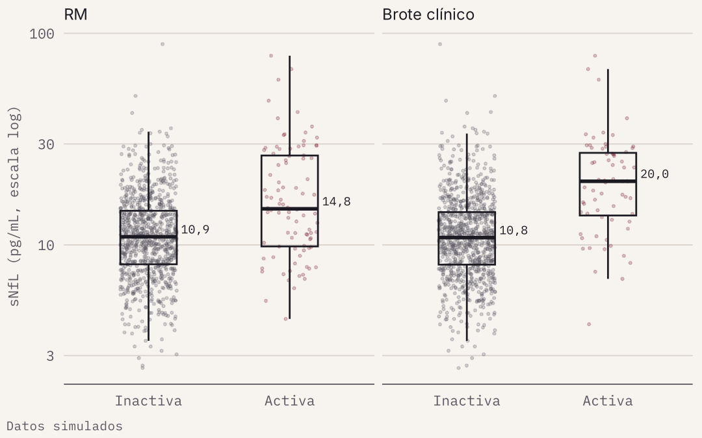
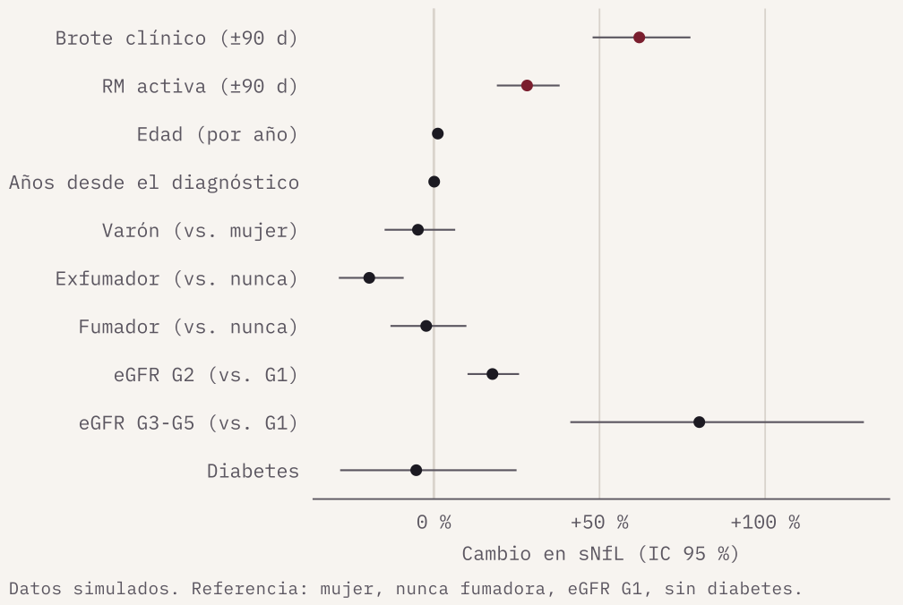
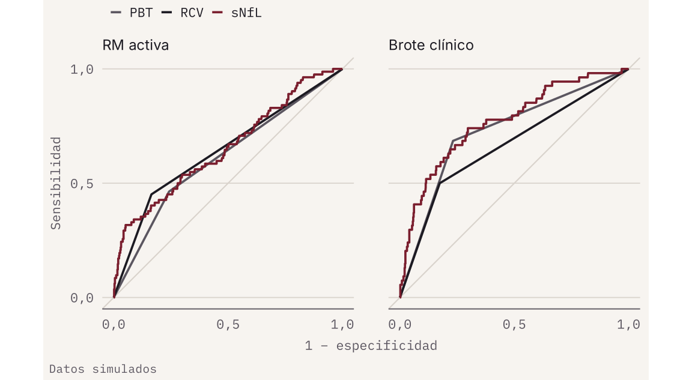
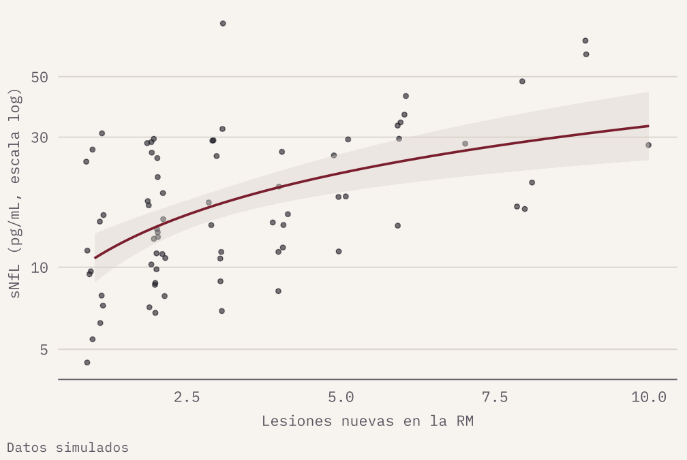
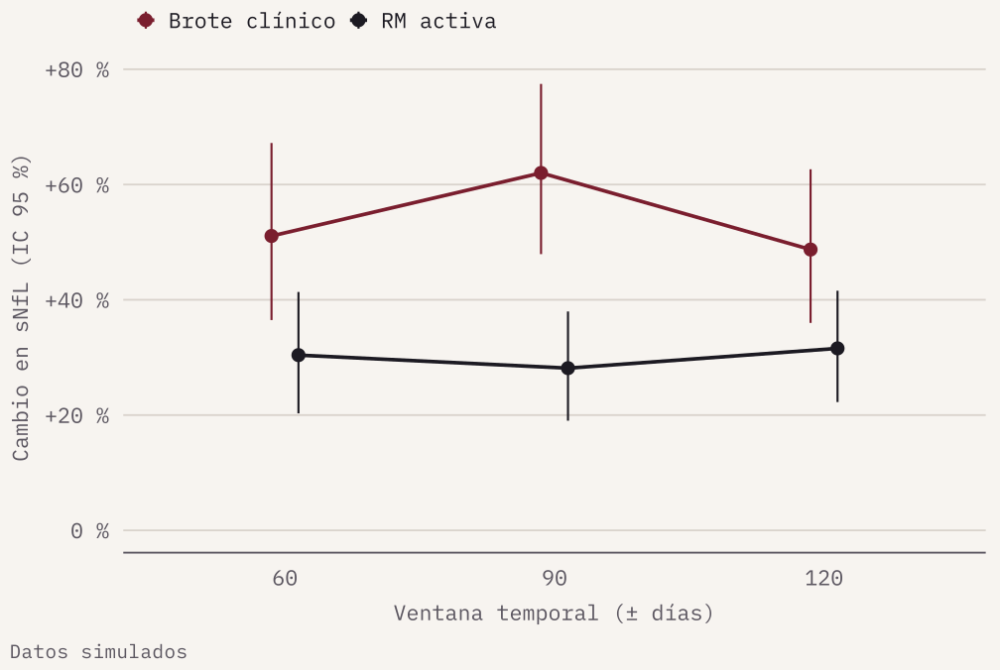

sNfL como biomarcador de actividad inflamatoria en la EMRR
================

- [0. Cabecera](#0-cabecera)
- [1. Configuración](#1-configuración)
- [2. Datos](#2-datos)
- [3. Descriptivos](#3-descriptivos)
- [4. Análisis principal](#4-análisis-principal)
  - [4.1. Objetivo 1: ¿cuánto sube la sNfL con la
    actividad?](#41-objetivo-1-cuánto-sube-la-snfl-con-la-actividad)
  - [4.2. Objetivo 2: RCV y PBT como marcadores de
    actividad](#42-objetivo-2-rcv-y-pbt-como-marcadores-de-actividad)
  - [4.3. Objetivo 3: rendimiento
    diagnóstico](#43-objetivo-3-rendimiento-diagnóstico)
  - [4.4. Objetivo 4: sNfL y número de lesiones
    nuevas](#44-objetivo-4-snfl-y-número-de-lesiones-nuevas)
- [5. Análisis de sensibilidad](#5-análisis-de-sensibilidad)
  - [5.1. Efecto de la edad sin actividad
    inflamatoria](#51-efecto-de-la-edad-sin-actividad-inflamatoria)
  - [5.2. eGFR independiente de la
    edad](#52-egfr-independiente-de-la-edad)
  - [5.3. Interacciones: edad y tabaquismo con la
    actividad](#53-interacciones-edad-y-tabaquismo-con-la-actividad)
  - [5.4. Solo determinaciones con RM dentro de la
    ventana](#54-solo-determinaciones-con-rm-dentro-de-la-ventana)
  - [5.5. Otras ventanas temporales: ±60 y ±120
    días](#55-otras-ventanas-temporales-60-y-120-días)
  - [5.6. ROC con una determinación por
    paciente](#56-roc-con-una-determinación-por-paciente)
- [6. Figuras](#6-figuras)
- [7. Información de la sesión](#7-información-de-la-sesión)

## 0. Cabecera

**Artículo:** Serum neurofilament light chain as a biomarker of
inflammatory activity in relapsing-remitting multiple sclerosis: a
real-world longitudinal cohort study. *Clin Chem Lab Med* 2026.
<https://doi.org/10.1515/cclm-2026-0944>

**Objetivos**

1.  Estimar cuánto sube la cadena ligera de neurofilamentos en suero
    (sNfL) con la actividad inflamatoria (brote clínico y RM activa),
    ajustando por edad, función renal y otros factores.
2.  Comparar dos formas de interpretar un resultado: el **valor de
    referencia del cambio (RCV)**, que compara con la determinación
    anterior del mismo paciente, y el **umbral poblacional (PBT)**, que
    compara con sanos de la misma edad.
3.  Medir el rendimiento diagnóstico de RCV, PBT y sNfL continua.
4.  Ver si la sNfL refleja la carga de lesiones nuevas en la RM.

**Diseño.** Cohorte retrospectiva. Determinaciones de sNfL repetidas en
pacientes con esclerosis múltiple remitente-recurrente (EMRR),
emparejadas en el tiempo con RM y brotes clínicos.

**Datos.** Tres tablas, como en la práctica clínica:

| Tabla               | Una fila por…         | Variables                                                                                                                                      |
|---------------------|-----------------------|------------------------------------------------------------------------------------------------------------------------------------------------|
| `data/nfl.csv`      | determinación de sNfL | `patient_id`, `nfl_date`, `nfl` (pg/mL), `age`, `years_since_dx`, `sex`, `smoking` (Never/Former/Current), `egfr` (mL/min/1,73 m²), `diabetes` |
| `data/mri.csv`      | RM                    | `patient_id`, `mri_date`, `mri_active` (lesiones T2 nuevas: 1/0), `n_lesions`                                                                  |
| `data/relapses.csv` | brote confirmado      | `patient_id`, `relapse_date`                                                                                                                   |

> **Datos simulados.** Este repositorio no contiene datos de pacientes.
> Las tres tablas las genera `R/simular_datos.R` con la misma estructura
> que los datos reales y efectos parecidos a los publicados. Las cifras
> se parecen, pero no son las del artículo.

## 1. Configuración

``` r
library(dplyr)
library(tidyr)
library(ggplot2)
library(lme4)         # modelos lineales mixtos
library(performance)  # coeficiente de correlación intraclase (CCI)
library(sandwich)     # errores estándar robustos por paciente
library(lmtest)
library(pROC)         # curvas ROC y test de DeLong

source("R/funciones.R")
source("R/theme_pmenor.R")
usar_pmenor(base_size = 12, fondo = "papel")

set.seed(2026)   # fija el jitter de las figuras para que se reproduzcan igual

# Ventana temporal para emparejar sNfL con RM y brotes (días)
WINDOW_DAYS  <- 90
WINDOWS_SENS <- c(60, 90, 120)   # análisis de sensibilidad

# RCV: variación analítica (CVA, control de calidad propio del laboratorio)
# y biológica intraindividual (CVI, base de datos de variación biológica de la EFLM)
CVA <- 0.060
CVI <- 0.0864
RCV <- rcv_increase(CVA, CVI)   # aumento significativo frente a la determinación previa
round(100 * RCV, 1)
```

    #> [1] 27.7

``` r
# PBT: límite superior de referencia (percentil 95) de sanos por décadas de
# edad, medidos con Lumipulse G (Varelli et al., 282 sujetos; los mismos
# límites que se usaron en el estudio)
PBT_LIMITS <- tribble(
  ~age_min, ~age_max, ~upper_limit,
  18,        29,        9.4,
  30,        39,        9.6,
  40,        49,       13.3,
  50,        59,       21.2,
  60,        69,       28.1,
  70,        90,       46.8
)

# Función renal: categorías KDIGO
egfr_kdigo <- function(egfr) {
  factor(case_when(is.na(egfr) ~ NA_character_,
                   egfr >= 90  ~ "G1 (>=90)",
                   egfr >= 60  ~ "G2 (60-89)",
                   TRUE        ~ "G3-G5 (<60)"),
         levels = c("G1 (>=90)", "G2 (60-89)", "G3-G5 (<60)"))
}
```

> **Sobre la fórmula del RCV.** Se usa la versión log-normal (27,7 %),
> la adecuada para la sNfL. La fórmula simétrica clásica daría un 24,5
> %. Las dos se explican en el README.

## 2. Datos

``` r
if (!file.exists("data/nfl.csv")) source("R/simular_datos.R")

read_dates <- \(f, cols) read.csv(f) |> mutate(across(all_of(cols), as.Date))
nfl      <- read_dates("data/nfl.csv", "nfl_date")
mri      <- read_dates("data/mri.csv", "mri_date")
relapses <- read_dates("data/relapses.csv", "relapse_date")

# RCV: cambio frente a la determinación anterior del mismo paciente.
# La primera determinación de cada paciente no tiene RCV.
# PBT: comparación con el límite superior de su década de edad.
nfl <- nfl |>
  arrange(patient_id, nfl_date) |>
  group_by(patient_id) |>
  mutate(pct_change = nfl / lag(nfl) - 1,
         rcv_bin    = as.integer(pct_change > RCV)) |>
  ungroup() |>
  mutate(age_years = floor(age)) |>   # años cumplidos, para asignar la década
  left_join(PBT_LIMITS, join_by(between(age_years, age_min, age_max))) |>
  mutate(pbt_bin = as.integer(nfl > upper_limit)) |>
  select(-age_years, -age_min, -age_max)

# Emparejar cada determinación con su RM y sus brotes
prepare <- function(window_days) {
  match_events(select(nfl, patient_id, nfl_date), mri, relapses, window_days) |>
    left_join(nfl, by = c("patient_id", "nfl_date")) |>
    mutate(
      mri_active = mri_active_w,
      relapse    = relapse_w,
      log_nfl    = log(nfl),
      egfr_kdigo = egfr_kdigo(egfr),
      egfr_bin   = factor(ifelse(egfr_kdigo == "G1 (>=90)", "G1", "G2-G5"), levels = c("G1", "G2-G5")),
      sex        = factor(sex, levels = c("Female", "Male")),
      smoking    = factor(smoking, levels = c("Never", "Former", "Current")),
      diabetes   = factor(diabetes, levels = c("No", "Yes")),
      # Edad y tiempo desde el diagnóstico centrados en la media de la cohorte
      age_c      = age - mean(age, na.rm = TRUE),
      t_dx_c     = years_since_dx - mean(years_since_dx, na.rm = TRUE)
    )
}
analysis_df <- prepare(WINDOW_DAYS)

glimpse(analysis_df)
```

    #> Rows: 1,000
    #> Columns: 27
    #> $ patient_id     <chr> "P001", "P001", "P001", "P002", "P002", "P002", "P002",…
    #> $ nfl_date       <date> 2023-06-23, 2023-11-20, 2023-12-11, 2023-07-10, 2023-1…
    #> $ relapse_w      <int> 0, 0, 0, 0, 0, 0, 0, 0, 0, 0, 0, 0, 0, 0, 0, 0, 1, 1, 1…
    #> $ mri_date       <date> 2023-11-28, 2023-11-28, 2023-11-28, 2023-12-18, 2023-1…
    #> $ mri_active     <int> 0, 1, 1, 0, 0, 0, 0, 0, 1, 0, 0, 0, 0, 0, 0, 0, 1, 1, 1…
    #> $ n_lesions      <int> 2, 2, 2, 0, 0, 0, 0, 0, 4, 0, 0, 0, 0, 0, 0, 0, 6, 6, 6…
    #> $ days_nfl_mri   <int> -158, -8, 13, -161, -33, 183, 10, 200, -16, -247, -86, …
    #> $ mri_within_w   <int> 0, 1, 1, 0, 1, 0, 1, 0, 1, 0, 1, 1, 0, 1, 0, 1, 1, 1, 1…
    #> $ mri_active_w   <int> 0, 1, 1, 0, 0, 0, 0, 0, 1, 0, 0, 0, 0, 0, 0, 0, 1, 1, 1…
    #> $ n_lesions_w    <int> NA, 2, 2, NA, NA, NA, NA, NA, 4, NA, NA, NA, NA, NA, NA…
    #> $ nfl            <dbl> 18.83, 10.23, 13.79, 15.04, 13.74, 14.91, 18.82, 16.90,…
    #> $ age            <dbl> 47.7, 48.1, 48.2, 44.2, 44.5, 45.1, 45.7, 46.2, 46.8, 4…
    #> $ years_since_dx <dbl> 6.3, 6.7, 6.8, 11.4, 11.8, 12.3, 12.9, 13.5, 14.0, 1.7,…
    #> $ sex            <fct> Female, Female, Female, Female, Female, Female, Female,…
    #> $ smoking        <fct> Former, Former, Former, Never, Never, Never, Never, Nev…
    #> $ egfr           <int> 89, 101, 96, 71, 73, 74, 74, 64, 65, 99, 102, 97, 85, 8…
    #> $ diabetes       <fct> No, No, No, No, No, No, No, No, No, No, No, No, No, No,…
    #> $ pct_change     <dbl> NA, -0.45671800, 0.34799609, NA, -0.08643617, 0.0851528…
    #> $ rcv_bin        <int> NA, 0, 1, NA, 0, 0, 0, 0, 1, NA, 0, 0, NA, 0, NA, 0, 1,…
    #> $ upper_limit    <dbl> 13.3, 13.3, 13.3, 13.3, 13.3, 13.3, 13.3, 13.3, 13.3, 1…
    #> $ pbt_bin        <int> 1, 0, 1, 1, 1, 1, 1, 1, 1, 0, 0, 0, 0, 0, 0, 0, 1, 1, 1…
    #> $ relapse        <int> 0, 0, 0, 0, 0, 0, 0, 0, 0, 0, 0, 0, 0, 0, 0, 0, 1, 1, 1…
    #> $ log_nfl        <dbl> 2.935451, 2.325325, 2.623944, 2.710713, 2.620311, 2.702…
    #> $ egfr_kdigo     <fct> G2 (60-89), G1 (>=90), G1 (>=90), G2 (60-89), G2 (60-89…
    #> $ egfr_bin       <fct> G2-G5, G1, G1, G2-G5, G2-G5, G2-G5, G2-G5, G2-G5, G2-G5…
    #> $ age_c          <dbl> 3.3577, 3.7577, 3.8577, -0.1423, 0.1577, 0.7577, 1.3577…
    #> $ t_dx_c         <dbl> -5.6567, -5.2567, -5.1567, -0.5567, -0.1567, 0.3433, 0.…

## 3. Descriptivos

``` r
# Características por paciente (primera determinación) y por determinación
analysis_df |>
  summarise(
    determinations    = n(),
    patients          = n_distinct(patient_id),
    dets_per_patient  = median(table(patient_id)),
    age_median        = median(age),
    years_dx_median   = median(years_since_dx),
    nfl_median        = median(nfl),
    nfl_q1            = quantile(nfl, 0.25),
    nfl_q3            = quantile(nfl, 0.75),
    mri_active_n      = sum(mri_active),
    relapse_n         = sum(relapse)
  ) |> as.data.frame()
```

    #>   determinations patients dets_per_patient age_median years_dx_median
    #> 1           1000      295                3       44.2            10.5
    #>   nfl_median nfl_q1  nfl_q3 mri_active_n relapse_n
    #> 1      11.11 8.1625 15.0475           90        67

``` r
patients <- analysis_df |> arrange(patient_id, nfl_date) |> distinct(patient_id, .keep_all = TRUE)
round(100 * prop.table(table(patients$sex)), 1)
```

    #> 
    #> Female   Male 
    #>   80.7   19.3

``` r
# Por determinación (pueden cambiar entre visitas, como la eGFR)
lapply(analysis_df[c("smoking", "egfr_kdigo", "diabetes")], table, useNA = "ifany")
```

    #> $smoking
    #> 
    #>   Never  Former Current    <NA> 
    #>     619     148     178      55 
    #> 
    #> $egfr_kdigo
    #> 
    #>   G1 (>=90)  G2 (60-89) G3-G5 (<60)        <NA> 
    #>         624         341          12          23 
    #> 
    #> $diabetes
    #> 
    #>   No  Yes <NA> 
    #>  916   31   53

**Proximidad temporal.** ¿A cuántos días de la RM emparejada está cada
determinación?

``` r
analysis_df |>
  filter(!is.na(days_nfl_mri)) |>
  group_by(mri_active) |>
  summarise(n = n(), median_days = median(abs(days_nfl_mri)),
            q1 = quantile(abs(days_nfl_mri), 0.25), q3 = quantile(abs(days_nfl_mri), 0.75),
            within_30d_pct = round(100 * mean(abs(days_nfl_mri) <= 30), 1),
            within_60d_pct = round(100 * mean(abs(days_nfl_mri) <= 60), 1))
```

    #> # A tibble: 2 × 7
    #>   mri_active     n median_days    q1    q3 within_30d_pct within_60d_pct
    #>        <int> <int>       <dbl> <dbl> <dbl>          <dbl>          <dbl>
    #> 1          0   910        114.    51 174             15.7           28.5
    #> 2          1    90         21      9  33.5           73.3           91.1

``` r
# Las "RM inactivas" incluyen las determinaciones sin RM dentro de la ventana
analysis_df |>
  filter(mri_active == 0) |>
  count(mri_within_window = mri_within_w == 1)
```

    #>   mri_within_window   n
    #> 1             FALSE 547
    #> 2              TRUE 363

``` r
activity_long <- bind_rows(
  analysis_df |> transmute(outcome = "RM", active = mri_active, nfl),
  analysis_df |> transmute(outcome = "Brote clínico", active = relapse, nfl)
) |>
  mutate(outcome = factor(outcome, levels = c("RM", "Brote clínico")),
         status  = factor(ifelse(active == 1, "Activa", "Inactiva"), levels = c("Inactiva", "Activa")))

medians <- activity_long |> group_by(outcome, status) |> summarise(med = median(nfl), .groups = "drop")

ggplot(activity_long, aes(status, nfl, colour = status)) +
  geom_jitter(width = 0.2, alpha = 0.25, size = 0.8) +
  geom_boxplot(outlier.shape = NA, width = 0.4, fill = NA, colour = pmenor_col[["tinta"]],
               linewidth = grosor_pmenor(3)) +
  geom_text(data = medians, aes(y = med, label = numeros_pmenor(accuracy = 0.1)(med)),
            nudge_x = 0.23, hjust = 0, vjust = -0.4, colour = pmenor_col[["tinta"]], size = 3.2) +
  scale_colour_manual(values = c(Inactiva = pmenor_col[["gris"]], Activa = pmenor_col[["burdeos"]]),
                      guide = "none") +
  scale_y_log10(labels = numeros_pmenor()) +
  facet_wrap(~ outcome) +
  labs(x = NULL, y = "sNfL (pg/mL, escala log)", caption = "Datos simulados")
```

<figure>

<figcaption aria-hidden="true">sNfL según la actividad
inflamatoria.</figcaption>
</figure>

## 4. Análisis principal

### 4.1. Objetivo 1: ¿cuánto sube la sNfL con la actividad?

Modelo lineal mixto sobre log(sNfL) con un intercepto aleatorio por
paciente: cada paciente tiene su propio nivel basal y sus
determinaciones no son independientes. Los coeficientes en escala log se
pasan a **% de cambio** con (e^β − 1) × 100.

El tratamiento modificador de la enfermedad no se incluye: la base de
datos solo recogía el tratamiento actual, no el que tenía el paciente en
cada determinación.

``` r
model_vars <- c("log_nfl", "relapse", "mri_active", "age_c", "t_dx_c",
                "sex", "smoking", "egfr_kdigo", "diabetes", "patient_id")
analysis_m1 <- analysis_df |> filter(if_all(all_of(model_vars), \(x) !is.na(x)))

c(determinations = nrow(analysis_m1), patients = n_distinct(analysis_m1$patient_id),
  excluded_missing = nrow(analysis_df) - nrow(analysis_m1))
```

    #>   determinations         patients excluded_missing 
    #>              875              262              125

``` r
m1 <- lmer(log_nfl ~ relapse + mri_active + age_c + t_dx_c + sex + smoking +
             egfr_kdigo + diabetes + (1 | patient_id),
           data = analysis_m1, REML = TRUE)

# CCI ajustado: qué parte de la variabilidad que queda se debe a diferencias
# estables entre pacientes
icc(m1)
```

    #> # Intraclass Correlation Coefficient
    #> 
    #>     Adjusted ICC: 0.641
    #>   Unadjusted ICC: 0.467

``` r
pct_change_table <- function(model) {
  est <- fixef(model)
  ci  <- confint(model, parm = "beta_", method = "Wald")
  data.frame(term = names(est), beta = est,
             t = coef(summary(model))[, "t value"],
             pct_change = 100 * (exp(est) - 1),
             ci_low = 100 * (exp(ci[, 1]) - 1), ci_high = 100 * (exp(ci[, 2]) - 1),
             row.names = NULL) |>
    filter(term != "(Intercept)") |>
    mutate(across(where(is.numeric), \(x) round(x, 2)))
}
table_m1 <- pct_change_table(m1)
table_m1
```

    #>                     term  beta     t pct_change ci_low ci_high
    #> 1                relapse  0.48 10.39      62.01  47.92   77.45
    #> 2             mri_active  0.25  6.58      28.14  19.02   37.97
    #> 3                  age_c  0.01  4.84       1.20   0.71    1.69
    #> 4                 t_dx_c  0.00  0.38       0.11  -0.44    0.65
    #> 5                sexMale -0.05 -0.86      -4.80 -14.86    6.45
    #> 6          smokingFormer -0.22 -3.50     -19.49 -28.68   -9.10
    #> 7         smokingCurrent -0.02 -0.39      -2.30 -13.09    9.83
    #> 8   egfr_kdigoG2 (60-89)  0.16  4.83      17.69  10.17   25.73
    #> 9  egfr_kdigoG3-G5 (<60)  0.59  4.74      80.13  41.19  129.80
    #> 10           diabetesYes -0.05 -0.39      -5.32 -28.28   24.97

``` r
labels_m1 <- c(relapse = "Brote clínico (±90 d)", mri_active = "RM activa (±90 d)",
               age_c = "Edad (por año)", t_dx_c = "Años desde el diagnóstico",
               sexMale = "Varón (vs. mujer)", smokingFormer = "Exfumador (vs. nunca)",
               smokingCurrent = "Fumador (vs. nunca)",
               `egfr_kdigoG2 (60-89)` = "eGFR G2 (vs. G1)",
               `egfr_kdigoG3-G5 (<60)` = "eGFR G3-G5 (vs. G1)", diabetesYes = "Diabetes")

table_m1 |>
  mutate(label = factor(labels_m1[term], levels = rev(labels_m1)),
         key = term %in% c("relapse", "mri_active")) |>
  ggplot(aes(pct_change, label)) +
  geom_vline(xintercept = 0, colour = pmenor_col[["linea"]]) +
  geom_errorbarh(aes(xmin = ci_low, xmax = ci_high), height = 0, colour = pmenor_col[["gris"]]) +
  geom_point(aes(colour = key), size = 2.4) +
  scale_colour_manual(values = c(`TRUE` = pmenor_col[["burdeos"]], `FALSE` = pmenor_col[["tinta"]]),
                      guide = "none") +
  scale_x_continuous(labels = \(x) paste0(ifelse(x > 0, "+", ""), x, " %")) +
  labs(x = "Cambio en sNfL (IC 95 %)", y = NULL,
       caption = "Datos simulados. Referencia: mujer, nunca fumadora, eGFR G1, sin diabetes.") +
  theme(panel.grid.major.y = element_blank(),
        panel.grid.major.x = element_line(colour = pmenor_col[["linea"]]))
```

<figure>

<figcaption aria-hidden="true">Efectos fijos del modelo mixto: % de
cambio en la sNfL (IC 95 %).</figcaption>
</figure>

### 4.2. Objetivo 2: RCV y PBT como marcadores de actividad

Regresión logística con la actividad como respuesta y RCV y PBT a la vez
como explicativas, ajustada por edad, sexo y eGFR. Como un mismo
paciente aporta varias determinaciones, los errores estándar son
robustos por paciente (*cluster-robust*). Tabaquismo y diabetes no se
incluyen: el RCV compara al paciente consigo mismo, así que los factores
estables ya quedan controlados.

``` r
fit_cluster_logit <- function(formula, data) {
  m  <- glm(formula, data = data, family = binomial)
  ct <- coeftest(m, vcov. = vcovCL(m, cluster = data$patient_id, type = "HC0"))
  data.frame(term = rownames(ct), or = exp(ct[, 1]),
             ci_low = exp(ct[, 1] - 1.96 * ct[, 2]), ci_high = exp(ct[, 1] + 1.96 * ct[, 2]),
             p = ct[, 4], row.names = NULL) |>
    filter(term %in% c("rcv_bin", "pbt_bin")) |>
    mutate(across(c(or, ci_low, ci_high), \(x) round(x, 2)), p = signif(p, 2))
}

df_obj2 <- analysis_df |> filter(!is.na(rcv_bin), !is.na(pbt_bin), !is.na(egfr_bin))
c(determinations = nrow(df_obj2), patients = n_distinct(df_obj2$patient_id))
```

    #> determinations       patients 
    #>            689            261

``` r
fit_cluster_logit(mri_active ~ rcv_bin + pbt_bin + age_c + sex + egfr_bin, df_obj2)
```

    #>      term   or ci_low ci_high       p
    #> 1 rcv_bin 3.32   2.07    5.32 6.8e-07
    #> 2 pbt_bin 2.17   1.11    4.23 2.3e-02

``` r
fit_cluster_logit(relapse    ~ rcv_bin + pbt_bin + age_c + sex + egfr_bin, df_obj2)
```

    #>      term   or ci_low ci_high       p
    #> 1 rcv_bin 3.17   1.72    5.84 0.00023
    #> 2 pbt_bin 4.83   1.84   12.65 0.00140

**¿Coinciden RCV y PBT?** Kappa de Cohen y, en los casos discordantes,
cuánta actividad hay en cada subgrupo.

``` r
tab_agree <- table(RCV = df_obj2$rcv_bin, PBT = df_obj2$pbt_bin)
tab_agree
```

    #>    PBT
    #> RCV   0   1
    #>   0 403 153
    #>   1  48  85

``` r
po <- sum(diag(tab_agree)) / sum(tab_agree)
pe <- sum(rowSums(tab_agree) * colSums(tab_agree)) / sum(tab_agree)^2
round(c(agreement = po, kappa = (po - pe) / (1 - pe)), 3)
```

    #> agreement     kappa 
    #>     0.708     0.280

``` r
df_obj2 |>
  filter(rcv_bin != pbt_bin) |>
  mutate(group = ifelse(rcv_bin == 1, "RCV+/PBT-", "PBT+/RCV-")) |>
  group_by(group) |>
  summarise(n = n(), mri_active_pct = round(100 * mean(mri_active), 1),
            relapse_pct = round(100 * mean(relapse), 1))
```

    #> # A tibble: 2 × 4
    #>   group         n mri_active_pct relapse_pct
    #>   <chr>     <int>          <dbl>       <dbl>
    #> 1 PBT+/RCV-   153           11.1        13.1
    #> 2 RCV+/PBT-    48           20.8        18.8

### 4.3. Objetivo 3: rendimiento diagnóstico

Curvas ROC de RCV, PBT y sNfL continua (en log) frente a RM activa y
frente a brote. Las AUC se comparan con el test de DeLong para curvas
correlacionadas (las tres se calculan sobre las mismas determinaciones).

``` r
df_roc <- analysis_df |> filter(!is.na(rcv_bin), !is.na(pbt_bin))
c(determinations = nrow(df_roc), patients = n_distinct(df_roc$patient_id),
  mri_events = sum(df_roc$mri_active), relapse_events = sum(df_roc$relapse))
```

    #> determinations       patients     mri_events relapse_events 
    #>            705            264             86             56

``` r
roc_set <- function(outcome) {
  y <- df_roc[[outcome]]
  list(RCV  = roc(y, df_roc$rcv_bin, quiet = TRUE, direction = "<", levels = c(0, 1)),
       PBT  = roc(y, df_roc$pbt_bin, quiet = TRUE, direction = "<", levels = c(0, 1)),
       sNfL = roc(y, df_roc$log_nfl, quiet = TRUE, direction = "<", levels = c(0, 1)))
}
auc_table <- function(rocs) {
  bind_rows(lapply(names(rocs), function(m) {
    ci <- ci.auc(rocs[[m]], method = "delong")
    data.frame(marker = m, auc = ci[2], ci_low = ci[1], ci_high = ci[3])
  })) |> mutate(across(where(is.numeric), \(x) round(x, 3)))
}
delong_table <- function(rocs) {
  pairs <- list(c("RCV", "PBT"), c("sNfL", "PBT"), c("sNfL", "RCV"))
  bind_rows(lapply(pairs, function(p) {
    t <- roc.test(rocs[[p[1]]], rocs[[p[2]]], method = "delong")
    data.frame(comparison = paste(p, collapse = " vs "),
               auc_diff = round(as.numeric(auc(rocs[[p[1]]]) - auc(rocs[[p[2]]])), 3),
               p = signif(t$p.value, 2))
  }))
}

rocs_mri <- roc_set("mri_active")
rocs_rel <- roc_set("relapse")

auc_table(rocs_mri);  delong_table(rocs_mri)
```

    #>   marker   auc ci_low ci_high
    #> 1    RCV 0.642  0.587   0.696
    #> 2    PBT 0.599  0.543   0.655
    #> 3   sNfL 0.653  0.586   0.719

    #>    comparison auc_diff     p
    #> 1  RCV vs PBT    0.043 0.200
    #> 2 sNfL vs PBT    0.053 0.031
    #> 3 sNfL vs RCV    0.011 0.760

``` r
auc_table(rocs_rel);  delong_table(rocs_rel)
```

    #>   marker   auc ci_low ci_high
    #> 1    RCV 0.667  0.599   0.734
    #> 2    PBT 0.689  0.625   0.752
    #> 3   sNfL 0.774  0.706   0.842

    #>    comparison auc_diff      p
    #> 1  RCV vs PBT   -0.022 0.6500
    #> 2 sNfL vs PBT    0.085 0.0033
    #> 3 sNfL vs RCV    0.107 0.0320

``` r
roc_long <- bind_rows(
  bind_rows(lapply(names(rocs_mri), \(m) data.frame(marker = m, outcome = "RM activa",
    fpr = 1 - rocs_mri[[m]]$specificities, tpr = rocs_mri[[m]]$sensitivities))),
  bind_rows(lapply(names(rocs_rel), \(m) data.frame(marker = m, outcome = "Brote clínico",
    fpr = 1 - rocs_rel[[m]]$specificities, tpr = rocs_rel[[m]]$sensitivities)))
) |>
  mutate(outcome = factor(outcome, levels = c("RM activa", "Brote clínico"))) |>
  arrange(marker, outcome, fpr, tpr)

ggplot(roc_long, aes(fpr, tpr, colour = marker)) +
  geom_abline(colour = pmenor_col[["linea"]]) +
  geom_path(linewidth = grosor_pmenor(4)) +
  scale_colour_manual(values = c(sNfL = pmenor_col[["burdeos"]], RCV = pmenor_col[["tinta"]],
                                 PBT = pmenor_col[["gris"]])) +
  scale_x_continuous(breaks = c(0, 0.5, 1), labels = numeros_pmenor()) +
  scale_y_continuous(breaks = c(0, 0.5, 1), labels = numeros_pmenor()) +
  coord_equal() +
  facet_wrap(~ outcome) +
  labs(x = "1 − especificidad", y = "Sensibilidad", caption = "Datos simulados") +
  theme(panel.spacing = unit(2, "lines"))
```

<figure>

<figcaption aria-hidden="true">Curvas ROC de RCV, PBT y sNfL
continua.</figcaption>
</figure>

**Puntos de trabajo de RCV y PBT**, con IC de Wilson:

``` r
bind_rows(
  operating_point(df_roc$mri_active, df_roc$rcv_bin, "RM activa · RCV"),
  operating_point(df_roc$mri_active, df_roc$pbt_bin, "RM activa · PBT"),
  operating_point(df_roc$relapse,    df_roc$rcv_bin, "Brote · RCV"),
  operating_point(df_roc$relapse,    df_roc$pbt_bin, "Brote · PBT")
)
```

    #>             label TP  FP  TN FN      sensitivity      specificity
    #> 1 RM activa · RCV 38  98 521 48 44.2 (34.2-54.7) 84.2 (81.1-86.8)
    #> 2 RM activa · PBT 45 201 418 41 52.3 (41.9-62.6) 67.5 (63.7-71.1)
    #> 3     Brote · RCV 28 108 541 28 50.0 (37.3-62.7) 83.4 (80.3-86.0)
    #> 4     Brote · PBT 39 207 442 17 69.6 (56.7-80.1) 68.1 (64.4-71.6)
    #>                ppv              npv
    #> 1 27.9 (21.1-36.0) 91.6 (89.0-93.6)
    #> 2 18.3 (14.0-23.6) 91.1 (88.1-93.3)
    #> 3 20.6 (14.6-28.1) 95.1 (93.0-96.6)
    #> 4 15.9 (11.8-20.9) 96.3 (94.1-97.7)

**Punto de corte óptimo de sNfL continua** (índice de Youden), con IC
por bootstrap (2.000 remuestreos). El umbral se calcula en log y se
devuelve en pg/mL.

``` r
youden_to_pgml <- function(res) {
  res |> mutate(across(c(estimate, ci_low, ci_high),
                       \(x) ifelse(metric == "threshold", exp(x), x)),
                across(where(is.numeric), \(x) round(x, 3)))
}
youden_to_pgml(youden_boot(df_roc$mri_active, df_roc$log_nfl))
```

    #>        metric estimate ci_low ci_high
    #> 1   threshold   23.790 12.695  25.314
    #> 2 sensitivity    0.302  0.241   0.685
    #> 3 specificity    0.950  0.619   0.967
    #> 4         ppv    0.456  0.167   0.583
    #> 5         npv    0.907  0.891   0.943

``` r
youden_to_pgml(youden_boot(df_roc$relapse, df_roc$log_nfl))
```

    #>        metric estimate ci_low ci_high
    #> 1   threshold   14.010 12.875  19.930
    #> 2 sensitivity    0.750  0.500   0.857
    #> 3 specificity    0.698  0.643   0.907
    #> 4         ppv    0.176  0.139   0.373
    #> 5         npv    0.970  0.950   0.984

> El punto de corte de Youden se calcula y se evalúa con los mismos
> datos, así que su rendimiento está sobrestimado. Es exploratorio.

### 4.4. Objetivo 4: sNfL y número de lesiones nuevas

Solo determinaciones emparejadas con una RM activa y con el recuento de
lesiones disponible. En el estudio real, además, solo entraban las RM
con una RM previa de comparación en el mismo centro en los 2,5 años
anteriores.

``` r
lesions <- analysis_df |>
  filter(mri_active == 1, !is.na(n_lesions_w)) |>
  mutate(log_lesions = log(n_lesions_w + 1))

c(n = nrow(lesions), median_lesions = median(lesions$n_lesions_w))
```

    #>              n median_lesions 
    #>             75              3

``` r
cor.test(lesions$log_nfl, lesions$n_lesions_w, method = "spearman", exact = FALSE)
```

    #> 
    #>  Spearman's rank correlation rho
    #> 
    #> data:  lesions$log_nfl and lesions$n_lesions_w
    #> S = 35450, p-value = 6.117e-06
    #> alternative hypothesis: true rho is not equal to 0
    #> sample estimates:
    #>       rho 
    #> 0.4957335

``` r
cor.test(lesions$log_nfl, lesions$log_lesions, method = "pearson")   # escala log-log
```

    #> 
    #>  Pearson's product-moment correlation
    #> 
    #> data:  lesions$log_nfl and lesions$log_lesions
    #> t = 5.1746, df = 73, p-value = 1.935e-06
    #> alternative hypothesis: true correlation is not equal to 0
    #> 95 percent confidence interval:
    #>  0.3298575 0.6666208
    #> sample estimates:
    #>       cor 
    #> 0.5180365

``` r
m_lesions <- lm(log_nfl ~ log_lesions + age + sex, data = lesions)
summary(m_lesions)
```

    #> 
    #> Call:
    #> lm(formula = log_nfl ~ log_lesions + age + sex, data = lesions)
    #> 
    #> Residuals:
    #>     Min      1Q  Median      3Q     Max 
    #> -0.8774 -0.4227 -0.1107  0.3835  1.5574 
    #> 
    #> Coefficients:
    #>              Estimate Std. Error t value Pr(>|t|)    
    #> (Intercept)  1.376431   0.343625   4.006  0.00015 ***
    #> log_lesions  0.646257   0.126811   5.096 2.75e-06 ***
    #> age          0.012338   0.006578   1.876  0.06482 .  
    #> sexMale     -0.113590   0.162145  -0.701  0.48587    
    #> ---
    #> Signif. codes:  0 '***' 0.001 '**' 0.01 '*' 0.05 '.' 0.1 ' ' 1
    #> 
    #> Residual standard error: 0.518 on 71 degrees of freedom
    #> Multiple R-squared:  0.3042, Adjusted R-squared:  0.2748 
    #> F-statistic: 10.35 on 3 and 71 DF,  p-value: 9.881e-06

``` r
# Cuánto sube la sNfL cada vez que se duplica el número de lesiones
# (de 1 a 2, de 2 a 4…: el cambio en log(n + 1) varía un poco según el punto)
b <- coef(m_lesions)[["log_lesions"]]
round(100 * (exp(b * log(c(3 / 2, 5 / 3, 9 / 5))) - 1), 1)
```

    #> [1] 30.0 39.1 46.2

``` r
ggplot(lesions, aes(n_lesions_w, nfl)) +
  geom_jitter(width = 0.15, alpha = 0.6, size = 1.4) +
  geom_smooth(method = "lm", formula = y ~ log(x + 1), linewidth = grosor_pmenor(4)) +
  scale_y_log10(labels = numeros_pmenor()) +
  labs(x = "Lesiones nuevas en la RM", y = "sNfL (pg/mL, escala log)",
       caption = "Datos simulados")
```

<figure>

<figcaption aria-hidden="true">sNfL frente al número de lesiones nuevas
en la RM.</figcaption>
</figure>

**¿A partir de cuántas lesiones se eleva RCV o PBT?** Aquí el número de
lesiones es el predictor y la positividad de RCV o PBT, la respuesta.

``` r
lesions_b <- lesions |> filter(!is.na(rcv_bin), !is.na(pbt_bin))
nrow(lesions_b)
```

    #> [1] 71

``` r
bind_rows(lapply(c("rcv_bin", "pbt_bin"), function(marker) {
  bind_rows(lapply(2:6, function(k)
    operating_point(lesions_b[[marker]], lesions_b$n_lesions_w >= k,
                    paste0(toupper(sub("_bin", "", marker)), " · >= ", k, " lesiones"))))
})) |> select(label, sensitivity, specificity, npv)
```

    #>                  label      sensitivity      specificity              npv
    #> 1  RCV · >= 2 lesiones 93.8 (79.9-98.3) 28.2 (16.5-43.8) 84.6 (57.8-95.7)
    #> 2  RCV · >= 3 lesiones 62.5 (45.3-77.1) 56.4 (41.0-70.7) 64.7 (47.9-78.5)
    #> 3  RCV · >= 4 lesiones 50.0 (33.6-66.4) 71.8 (56.2-83.5) 63.6 (48.9-76.2)
    #> 4  RCV · >= 5 lesiones 37.5 (22.9-54.7) 82.1 (67.3-91.0) 61.5 (48.0-73.5)
    #> 5  RCV · >= 6 lesiones 28.1 (15.6-45.4) 87.2 (73.3-94.4) 59.6 (46.7-71.4)
    #> 6  PBT · >= 2 lesiones 89.7 (76.4-95.9) 28.1 (15.6-45.4) 69.2 (42.4-87.3)
    #> 7  PBT · >= 3 lesiones 66.7 (51.0-79.4) 65.6 (48.3-79.6) 61.8 (45.0-76.1)
    #> 8  PBT · >= 4 lesiones 51.3 (36.2-66.1) 78.1 (61.2-89.0) 56.8 (42.2-70.3)
    #> 9  PBT · >= 5 lesiones 43.6 (29.3-59.0) 93.8 (79.9-98.3) 57.7 (44.2-70.1)
    #> 10 PBT · >= 6 lesiones 33.3 (20.6-49.0) 96.9 (84.3-99.4) 54.4 (41.6-66.6)

``` r
for (marker in c("rcv_bin", "pbt_bin")) {
  r <- roc(lesions_b[[marker]], lesions_b$n_lesions_w, quiet = TRUE, direction = "<", levels = c(0, 1))
  print(round(c(auc = as.numeric(auc(r)), ci.auc(r, method = "delong")[c(1, 3)]), 3))
  print(coords(r, "best", best.method = "youden", transpose = FALSE))
}
```

    #>   auc             
    #> 0.664 0.540 0.788 
    #>   threshold specificity sensitivity
    #> 1       1.5   0.2820513      0.9375
    #>   auc             
    #> 0.720 0.603 0.837 
    #>   threshold specificity sensitivity
    #> 1       4.5      0.9375   0.4358974

> Con tan pocas determinaciones, estos puntos de corte son preliminares.

## 5. Análisis de sensibilidad

### 5.1. Efecto de la edad sin actividad inflamatoria

``` r
m_age <- lmer(log_nfl ~ age_c + sex + smoking + (1 | patient_id),
              data = filter(analysis_m1, relapse == 0, mri_active == 0), REML = TRUE)
pct_change_table(m_age) |> filter(term == "age_c")
```

    #>    term beta    t pct_change ci_low ci_high
    #> 1 age_c 0.02 6.16       1.51   1.03       2

### 5.2. eGFR independiente de la edad

La eGFR baja con la edad. Para separar los dos efectos se sustituye la
categoría KDIGO por el residuo de la eGFR una vez descontada la edad.

``` r
df_egfr <- analysis_m1 |> mutate(egfr_resid = resid(lm(egfr ~ age)))
m_egfr <- lmer(log_nfl ~ egfr_resid + age_c + relapse + mri_active + sex + smoking +
                 diabetes + (1 | patient_id), data = df_egfr, REML = TRUE)
pct_change_table(m_egfr) |> filter(term == "egfr_resid")   # % por cada mL/min/1,73 m²
```

    #>         term beta     t pct_change ci_low ci_high
    #> 1 egfr_resid    0 -3.46      -0.49  -0.76   -0.21

### 5.3. Interacciones: edad y tabaquismo con la actividad

Test de razón de verosimilitudes (los modelos se ajustan por máxima
verosimilitud, no REML, para poder compararlos).

``` r
m_main <- lmer(log_nfl ~ relapse + mri_active + age_c + t_dx_c + sex + smoking +
                 egfr_kdigo + diabetes + (1 | patient_id), data = analysis_m1, REML = FALSE)

m_age_int <- update(m_main, . ~ . + relapse:age_c + mri_active:age_c)
anova(m_main, m_age_int)
```

    #> Data: analysis_m1
    #> Models:
    #> m_main: log_nfl ~ relapse + mri_active + age_c + t_dx_c + sex + smoking + egfr_kdigo + diabetes + (1 | patient_id)
    #> m_age_int: log_nfl ~ relapse + mri_active + age_c + t_dx_c + sex + smoking + egfr_kdigo + diabetes + (1 | patient_id) + relapse:age_c + mri_active:age_c
    #>           npar    AIC    BIC  logLik deviance  Chisq Df Pr(>Chisq)
    #> m_main      13 543.74 605.81 -258.87   517.74                     
    #> m_age_int   15 547.04 618.65 -258.52   517.04 0.7078  2      0.702

``` r
m_smk_int <- update(m_main, . ~ . + relapse:smoking + mri_active:smoking)
anova(m_main, m_smk_int)
```

    #> Data: analysis_m1
    #> Models:
    #> m_main: log_nfl ~ relapse + mri_active + age_c + t_dx_c + sex + smoking + egfr_kdigo + diabetes + (1 | patient_id)
    #> m_smk_int: log_nfl ~ relapse + mri_active + age_c + t_dx_c + sex + smoking + egfr_kdigo + diabetes + (1 | patient_id) + relapse:smoking + mri_active:smoking
    #>           npar    AIC    BIC  logLik deviance  Chisq Df Pr(>Chisq)    
    #> m_main      13 543.74 605.81 -258.87   517.74                         
    #> m_smk_int   17 529.10 610.26 -247.55   495.10 22.645  4  0.0001491 ***
    #> ---
    #> Signif. codes:  0 '***' 0.001 '**' 0.01 '*' 0.05 '.' 0.1 ' ' 1

``` r
# sNfL mediana por tabaquismo, con y sin actividad
analysis_df |>
  filter(!is.na(smoking)) |>
  mutate(activity = ifelse(mri_active == 1 | relapse == 1, "active", "inactive")) |>
  group_by(smoking, activity) |>
  summarise(n = n(), nfl_median = round(median(nfl), 1), .groups = "drop") |>
  pivot_wider(names_from = activity, values_from = c(n, nfl_median))
```

    #> # A tibble: 3 × 5
    #>   smoking n_active n_inactive nfl_median_active nfl_median_inactive
    #>   <fct>      <int>      <int>             <dbl>               <dbl>
    #> 1 Never         66        553              18.6                11.1
    #> 2 Former        20        128              10.1                 9.2
    #> 3 Current       28        150              13.7                10.7

``` r
# Características por tabaquismo
analysis_df |>
  filter(!is.na(smoking)) |>
  group_by(smoking) |>
  summarise(n = n(), age_median = median(age),
            egfr_g2_g5_pct = round(100 * mean(egfr_bin == "G2-G5", na.rm = TRUE), 1),
            mri_active_pct = round(100 * mean(mri_active), 1),
            relapse_pct = round(100 * mean(relapse), 1))
```

    #> # A tibble: 3 × 6
    #>   smoking     n age_median egfr_g2_g5_pct mri_active_pct relapse_pct
    #>   <fct>   <int>      <dbl>          <dbl>          <dbl>       <dbl>
    #> 1 Never     619       44.4           39.3            8.2         5.8
    #> 2 Former    148       47.8           36.4           10.8         6.8
    #> 3 Current   178       42.8           31.4           11.2         8.4

### 5.4. Solo determinaciones con RM dentro de la ventana

En el análisis principal, una determinación sin RM a ±90 días cuenta
como “RM inactiva”. Es una clasificación conservadora: si hubo actividad
no vista, diluye el efecto. Aquí se repite el modelo solo con las
determinaciones que tienen una RM real dentro de la ventana.

``` r
m_within <- update(m1, data = filter(analysis_m1, mri_within_w == 1))
c(determinations = nrow(filter(analysis_m1, mri_within_w == 1)))
```

    #> determinations 
    #>            400

``` r
pct_change_table(m_within) |> filter(term %in% c("relapse", "mri_active"))
```

    #>         term beta    t pct_change ci_low ci_high
    #> 1    relapse 0.52 8.69      68.68  49.91   89.81
    #> 2 mri_active 0.20 4.26      22.42  11.54   34.36

### 5.5. Otras ventanas temporales: ±60 y ±120 días

``` r
windows <- bind_rows(lapply(WINDOWS_SENS, function(w) {
  d <- prepare(w) |> filter(if_all(all_of(model_vars), \(x) !is.na(x)))
  m <- update(m1, data = d)
  pct_change_table(m) |>
    filter(term %in% c("relapse", "mri_active")) |>
    mutate(window = w, events = c(sum(d$relapse), sum(d$mri_active)))
}))
windows |> select(window, term, events, pct_change, ci_low, ci_high)
```

    #>   window       term events pct_change ci_low ci_high
    #> 1     60    relapse     48      51.07  36.48   67.21
    #> 2     60 mri_active     73      30.40  20.29   41.35
    #> 3     90    relapse     58      62.01  47.92   77.45
    #> 4     90 mri_active     80      28.14  19.02   37.97
    #> 5    120    relapse     67      48.72  35.99   62.64
    #> 6    120 mri_active     87      31.57  22.26   41.57

``` r
windows |>
  mutate(term = ifelse(term == "relapse", "Brote clínico", "RM activa")) |>
  ggplot(aes(factor(window), pct_change, colour = term, group = term)) +
  geom_line(position = position_dodge(0.2)) +
  geom_pointrange(aes(ymin = ci_low, ymax = ci_high), position = position_dodge(0.2)) +
  scale_colour_manual(values = c(`Brote clínico` = pmenor_col[["burdeos"]],
                                 `RM activa` = pmenor_col[["tinta"]])) +
  scale_y_continuous(labels = \(x) paste0(ifelse(x > 0, "+", ""), x, " %"), limits = c(0, NA)) +
  labs(x = "Ventana temporal (± días)", y = "Cambio en sNfL (IC 95 %)",
       caption = "Datos simulados")
```

<figure>

<figcaption aria-hidden="true">Efecto de la actividad sobre la sNfL
según la ventana temporal.</figcaption>
</figure>

### 5.6. ROC con una determinación por paciente

Las AUC del apartado 4.3 usan varias determinaciones por paciente. Para
ver si eso las sesga, se repiten con una sola: la más cercana a un
evento activo si lo hay y, si no, la más cercana a la RM.

``` r
patient_level_auc <- function(outcome) {
  d <- df_roc |>
    group_by(patient_id) |>
    arrange(desc(.data[[outcome]]), abs(days_nfl_mri), .by_group = TRUE) |>
    slice(1) |>
    ungroup()
  rocs <- list(RCV  = roc(d[[outcome]], d$rcv_bin, quiet = TRUE, direction = "<", levels = c(0, 1)),
               PBT  = roc(d[[outcome]], d$pbt_bin, quiet = TRUE, direction = "<", levels = c(0, 1)),
               sNfL = roc(d[[outcome]], d$log_nfl, quiet = TRUE, direction = "<", levels = c(0, 1)))
  auc_table(rocs) |> mutate(outcome = outcome, patients = nrow(d))
}
bind_rows(patient_level_auc("mri_active"), patient_level_auc("relapse"))
```

    #>   marker   auc ci_low ci_high    outcome patients
    #> 1    RCV 0.634  0.566   0.701 mri_active      264
    #> 2    PBT 0.576  0.505   0.647 mri_active      264
    #> 3   sNfL 0.623  0.536   0.710 mri_active      264
    #> 4    RCV 0.673  0.586   0.761    relapse      264
    #> 5    PBT 0.691  0.609   0.773    relapse      264
    #> 6   sNfL 0.761  0.669   0.852    relapse      264

## 6. Figuras

Las figuras se guardan en `output/` al ejecutar el documento (secciones
3 a 5).

## 7. Información de la sesión

``` r
sessionInfo()
```

    #> R version 4.3.3 (2024-02-29)
    #> Platform: x86_64-pc-linux-gnu (64-bit)
    #> Running under: Ubuntu 24.04.5 LTS
    #> 
    #> Matrix products: default
    #> BLAS:   /usr/lib/x86_64-linux-gnu/blas/libblas.so.3.12.0 
    #> LAPACK: /usr/lib/x86_64-linux-gnu/lapack/liblapack.so.3.12.0
    #> 
    #> locale:
    #>  [1] LC_CTYPE=C.UTF-8       LC_NUMERIC=C           LC_TIME=C.UTF-8       
    #>  [4] LC_COLLATE=C.UTF-8     LC_MONETARY=C.UTF-8    LC_MESSAGES=C.UTF-8   
    #>  [7] LC_PAPER=C.UTF-8       LC_NAME=C              LC_ADDRESS=C          
    #> [10] LC_TELEPHONE=C         LC_MEASUREMENT=C.UTF-8 LC_IDENTIFICATION=C   
    #> 
    #> time zone: Atlantic/Canary
    #> tzcode source: system (glibc)
    #> 
    #> attached base packages:
    #> [1] stats     graphics  grDevices utils     datasets  methods   base     
    #> 
    #> other attached packages:
    #>  [1] data.table_1.14.10 pROC_1.18.5        lmtest_0.9-40      zoo_1.8-12        
    #>  [5] sandwich_3.1-0     performance_0.10.8 lme4_1.1-35.1      Matrix_1.6-5      
    #>  [9] ggplot2_3.4.4      tidyr_1.3.1        dplyr_1.1.4       
    #> 
    #> loaded via a namespace (and not attached):
    #>  [1] utf8_1.2.4        generics_0.1.3    lattice_0.22-5    digest_0.6.34    
    #>  [5] magrittr_2.0.3    evaluate_0.23     grid_4.3.3        fastmap_1.1.1    
    #>  [9] plyr_1.8.9        mgcv_1.9-1        purrr_1.0.2       fansi_1.0.5      
    #> [13] scales_1.3.0      cli_3.6.2         rlang_1.1.3       munsell_0.5.0    
    #> [17] splines_4.3.3     withr_2.5.0       yaml_2.3.8        tools_4.3.3      
    #> [21] nloptr_2.0.3      minqa_1.2.6       colorspace_2.1-0  boot_1.3-30      
    #> [25] vctrs_0.6.5       R6_2.5.1          lifecycle_1.0.4   MASS_7.3-60.0.1  
    #> [29] insight_0.19.8    pkgconfig_2.0.3   pillar_1.9.0      gtable_0.3.4     
    #> [33] glue_1.7.0        Rcpp_1.0.12       systemfonts_1.0.5 xfun_0.41        
    #> [37] tibble_3.2.1      tidyselect_1.2.0  highr_0.10        knitr_1.45       
    #> [41] farver_2.1.1      htmltools_0.5.7   nlme_3.1-164      labeling_0.4.3   
    #> [45] rmarkdown_2.25    compiler_4.3.3
